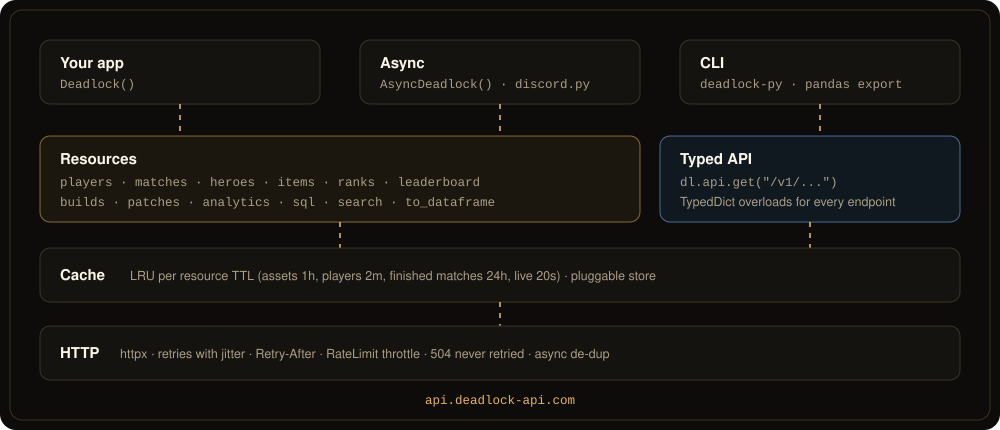

<div align="center">

<a href="https://github.com/justinjd00/deadlock-sdk-python"></a>

<p>
<a href="https://pypi.org/project/deadlock-sdk/"></a> <a href="https://pypi.org/project/deadlock-sdk/"></a> <a href="https://pypi.org/project/deadlock-sdk/"></a> <a href="https://pypi.org/project/deadlock-sdk/"></a> <a href="https://pypi.org/project/deadlock-sdk/"></a>
<br>
<a href="https://github.com/justinjd00/deadlock-sdk-python/actions/workflows/ci.yml"></a> <a href="https://github.com/justinjd00/deadlock-sdk-python/actions/workflows/contract.yml"></a> <a href="https://pypi.org/project/deadlock-sdk/#files"></a> <a href="https://github.com/justinjd00/deadlock-sdk-python/blob/main/LICENSE"></a>
<br>
<a href="https://github.com/justinjd00/deadlock-sdk-python/stargazers"></a> <a href="https://github.com/justinjd00/deadlock-sdk-python/releases"></a> <a href="https://github.com/justinjd00/deadlock-sdk-python/commits/main"></a> <a href="https://github.com/justinjd00/deadlock-sdk-python/issues"></a>
</p>

<p>
<a href="#quick-start"><b>Quick start</b></a> &nbsp;·&nbsp;
<a href="#async"><b>Async</b></a> &nbsp;·&nbsp;
<a href="#pandas"><b>pandas</b></a> &nbsp;·&nbsp;
<a href="#api"><b>API</b></a> &nbsp;·&nbsp;
<a href="#cli"><b>CLI</b></a> &nbsp;·&nbsp;
<a href="#errors-retries-and-rate-limits"><b>Errors</b></a> &nbsp;·&nbsp;
<a href="https://github.com/justinjd00/deadlock-sdk-python/blob/main/CHANGELOG.md"><b>Changelog</b></a>
</p>

</div>

Python SDK for [Deadlock](https://store.steampowered.com/app/1422450/Deadlock/) stats, built on the community run [Deadlock API](https://deadlock-api.com). Every endpoint is typed from the API's OpenAPI spec, and on top of that you get what every bot, notebook and stats site ends up writing by hand: player cards, scoreboards with names, tier lists that respect sample size, counters and synergies, Steam id parsing, rank decoding, a sync and an async client, pandas export and a CLI.

```python
from deadlock_sdk import Deadlock

dl = Deadlock()

dl.players.summary("https://steamcommunity.com/profiles/76561197960287930")
# PlayerSummary(rank=PlayerRank(label='Oracle 4', image=...), recent=HistorySummary(win_rate=0.58, kda=3.4, ...), top_heroes=[...])

dl.heroes.tier_list(min_average_badge=81)  # S to D, ranked by confidence, Oracle and up
dl.heroes.counters("haze")  # who Haze beats and who beats Haze
dl.matches.scoreboard(127843366)  # both teams, hero and item names, KDA, souls, damage
dl.api.get("/v1/players/{account_id}/mate-stats", path_params={"account_id": 22202})  # anything else, typed
```

The same SDK exists for TypeScript: [justinjd00/deadlock-sdk](https://github.com/justinjd00/deadlock-sdk) on npm.

## Live from the Deadlock API

Pulled straight from the API this package talks to, refreshed hourly.

<p align="center">
<a href="https://deadlock-api.com"></a> <a href="https://deadlock-api.com"></a> <a href="https://deadlock-api.com"></a> <a href="https://deadlock-api.com"></a>
</p>

## Highlights

<table>
<tr>
<td width="33%" valign="top">

### 🧬 Typed from the spec

All 237 schemas are generated as `TypedDict`, and every GET endpoint has an `@overload`, so `dl.api.get("/v1/...")` checks paths and parameters in mypy, pyright and your editor. A weekly job fails when the spec drifts.

</td>
<td width="33%" valign="top">

### ⚡ Sync and async

`Deadlock` for scripts and notebooks, `AsyncDeadlock` for discord.py, FastAPI and anything on asyncio. The sync client is generated from the async one, so both behave exactly the same.

</td>
<td width="33%" valign="top">

### 🎯 Stats done right

Tier lists and matchups rank by the Wilson lower bound, so a hero with 12 lucky games never tops the list. Pick rates account for 12 heroes per match.

</td>
</tr>
<tr>
<td valign="top">

### 🛡️ Plays nice with the API

Reads the `RateLimit-*` headers and waits for the window instead of hitting 429. Retries busy servers with `Retry-After`, never retries a 504 query timeout.

</td>
<td valign="top">

### 🐼 pandas ready

`to_dataframe()` flattens tier lists, scoreboards, player summaries or raw responses into a DataFrame. pandas stays optional.

</td>
<td valign="top">

### 🪪 Any Steam id

Account id, SteamID64, `[U:1:x]`, `STEAM_1:0:x` or a profile URL, every method takes them all. Vanity URLs get a clear error instead of a silent 404.

</td>
</tr>
</table>

## Quick start

```bash
pip install deadlock-sdk            # or: uv add deadlock-sdk
pip install "deadlock-sdk[pandas]"  # with DataFrame export
```

```python
from deadlock_sdk import Deadlock

with Deadlock(api_key=None) as dl:  # a key is optional, it raises your rate limits
    me = dl.players.summary("[U:1:22202]")
    print(me.rank.label if me.rank else "unranked", f"{me.recent.win_rate:.0%}")
    for hero in me.top_heroes:
        print(hero.name, hero.matches, f"{hero.win_rate:.0%}")
```

Requires Python 3.10 or newer. Runnable examples live in [`examples/`](https://github.com/justinjd00/deadlock-sdk-python/tree/main/examples): a [quick start](https://github.com/justinjd00/deadlock-sdk-python/blob/main/examples/quickstart.py), a [Discord bot](https://github.com/justinjd00/deadlock-sdk-python/blob/main/examples/discord_bot.py) with a `/rank` command and a [meta analysis](https://github.com/justinjd00/deadlock-sdk-python/blob/main/examples/meta_analysis.py) that shows which heroes get better the higher you climb.

## Async

Same methods, same results, just awaited. Independent requests inside the SDK run concurrently, and identical requests fired at the same time share one HTTP call.

```python
import asyncio
from deadlock_sdk import AsyncDeadlock


async def main() -> None:
    async with AsyncDeadlock() as dl:
        summary, tiers, board = await asyncio.gather(
            dl.players.summary(22202),
            dl.heroes.tier_list(min_average_badge=91),
            dl.leaderboard.get("na", limit=10),
        )


asyncio.run(main())
```

## pandas

```python
from deadlock_sdk import Deadlock, parse_badge
from deadlock_sdk.pandas import to_dataframe

dl = Deadlock()
df = to_dataframe(dl.heroes.stats(min_average_badge=parse_badge("oracle")))
df.sort_values("confidence", ascending=False)[["name", "win_rate", "pick_rate", "matches"]].head()
```

Nested results are flattened one level (`rank.label` becomes `rank_label`). Raw payloads are left out unless you pass `keep_raw=True`.

## API

Everything hangs off one client. Methods take an optional `options=CallOptions(fresh=True, timeout=10)` to skip the cache or override the timeout.

### Players

```python
dl.players.summary(player, matches=50)  # profile + rank + recent form + top heroes
dl.players.rank(player)  # PlayerRank(tier=8, subrank=4, label='Oracle 4', image=..., color=...)
dl.players.ranks([a, b, c])  # any number, batched by 1000
dl.players.match_history(player, limit=20, since=datetime(2026, 10, 1), match_modes=[4], hero_id=13)
dl.players.hero_stats(player)  # per hero totals
dl.players.enemy_stats(player)  # who they play against most
dl.players.mate_stats(player)  # who they queue with
dl.players.search("name")
dl.players.profiles([a, b])
```

Private players (403) and missing profiles do not break `summary`, those parts are just `None`.

### Matches

```python
board = dl.matches.scoreboard(match_id)
board.winners  # [ScoreboardPlayer(hero_name='Haze', kills=8, kda=4.25, net_worth=27259, final_items=[...]), ...]

dl.matches.get(match_id)  # full metadata: item timeline, stat snapshots, objectives
dl.matches.get_many(ids, include_player_info=True)  # bulk, split into requests of 1000
dl.matches.active(players=[player])  # live top matches, optionally with given players
```

### Heroes, items and ranks

```python
dl.heroes.list()  # playable heroes, only_active=False for all
dl.heroes.get("lady geist")  # by id, name or class name
dl.heroes.stats(min_average_badge=91)  # win rate, pick rate, KDA, souls, damage, confidence
dl.heroes.tier_list(min_matches=500, min_unix_timestamp=since)
dl.heroes.counters("haze")  # matchups, best first; worst_matchups() for the bad ones
dl.heroes.synergies("haze")  # best teammates

dl.items.shop(slot="spirit", tier=4)
dl.items.get("Spirit Snatch")
dl.items.stats(hero_id=13)  # win rate and average buy time per item

dl.ranks.decode(115)  # Badge(label='Eternus 5', image=...)
```

Filters are the API's own query parameters, passed as keyword arguments. Asset calls take a `language` (`"german"`, `"schinese"`, ...) or use the client default.

### Leaderboards, builds, patches

```python
dl.leaderboard.get("na", hero="abrams", limit=100)
dl.leaderboard.find("player name", "eu")
dl.builds.for_hero("haze", limit=5)  # most favorited this week
dl.patches.latest()
```

### Analytics, SQL and everything else

```python
# Any analytics endpoint by short name.
dl.analytics.get("item-permutation-stats", hero_id=13, comb_size=2)

# Read only SQL (DuckDB syntax) over the public dataset.
dl.sql.query(
    "SELECT hero_id, count(*) AS games FROM match_player WHERE start_time > now() - INTERVAL 1 DAY GROUP BY 1 ORDER BY 2 DESC"
)
dl.sql.tables()
dl.sql.schema("match_player")

# Any endpoint, typed end to end.
rows = dl.api.get("/v1/analytics/hero-comb-stats", query={"comb_size": 3, "min_matches": 100})
```

Raw response types are importable for your own code: `from deadlock_sdk.types import Hero, PlayerMatchHistoryEntry`.

### Helpers

No client needed:

```python
from deadlock_sdk import to_account_id, to_steam_id64, decode_badge, parse_badge, wilson_lower_bound

to_account_id("https://steamcommunity.com/profiles/76561197960287930")  # 22202
to_steam_id64("[U:1:22202]")  # '76561197960287930'
decode_badge(83).label  # 'Oracle 3'
parse_badge("oracle 3")  # 83, for min_average_badge filters
```

Also: `to_steam_id3`, `to_steam_id2`, `steam_profile_url`, `summarize_history`, `did_win`, `win_rate`, `kda`, `normalize_region`, `game_mode_name`, `match_mode_name`. `dl.search("hayz")` is a typo tolerant search over heroes and shop items.

## CLI

```bash
pip install deadlock-sdk
deadlock-py tiers --min-rank oracle
python -m deadlock_sdk hero haze   # same thing
```

<p align="center"></p>

Commands: `player`, `matches`, `rank`, `search`, `steamid`, `match`, `live`, `tiers`, `hero`, `items`, `leaderboard`, `patches` and `sql`. `<who>` is any Steam id, a profile URL or a Steam name. Every command takes `--json`, meta commands cover the last 30 days unless you pass `--days`, and `DEADLOCK_API_KEY` is picked up automatically.

## Errors, retries and rate limits

Every failure is a `DeadlockError` with a `code` you can branch on:

```python
from deadlock_sdk import DeadlockError

try:
    dl.players.rank(player)
except DeadlockError as error:
    if error.code == "FORBIDDEN":
        print("This player keeps their data private")
```

| Code                         | When                                                            |
| ---------------------------- | --------------------------------------------------------------- |
| `BAD_REQUEST`, `NOT_FOUND`   | 400, 404                                                        |
| `FORBIDDEN`                  | 403, usually a player who opted out                             |
| `RATE_LIMITED`               | 429 after retries, `retry_after` tells you how long             |
| `SERVICE_BUSY`               | 503, retried automatically                                      |
| `QUERY_TIMEOUT`              | 504, the query is too heavy. Narrow it, retrying would not help |
| `TIMEOUT`, `NETWORK_ERROR`   | client side                                                     |
| `INVALID_INPUT`              | bad Steam id, unknown region or rank, missing path parameter    |

GET requests are retried with exponential backoff and jitter (`retry=RetryPolicy(retries=2, min_delay=0.4, max_delay=15)`, or `None`). When the API reports `RateLimit-Remaining: 0` the client waits for the window to reset before the next request (`throttle=False` to opt out). `on_retry=` lets you log every retry.

## Caching

```python
Deadlock(
    ttl={"players": 60},  # seconds, per resource
    cache=MyRedisStore(),  # anything with get, set, clear; or False to turn it off
)
```

Defaults: assets 1h, analytics 30m, players 2m, finished matches 24h, live data 20s. The cache key is the full URL, so different filters never collide. Pass your own `httpx.Client` / `httpx.AsyncClient` with `http_client=` for proxies or custom transports.

## How it fits together

<p align="center"></p>

## Credits

All data comes from the [Deadlock API](https://deadlock-api.com), a free community project ([GitHub](https://github.com/deadlock-api)). If you build something with it, credit them; `ATTRIBUTION` has a ready made line. This package is not affiliated with Valve or the Deadlock API team. Deadlock is a trademark of Valve Corporation.

## Contributing

Issues and pull requests are welcome, see [CONTRIBUTING.md](https://github.com/justinjd00/deadlock-sdk-python/blob/main/CONTRIBUTING.md). Tests run offline against trimmed and anonymized real responses, and a weekly job checks the SDK against the live API.

## License

[MIT](https://github.com/justinjd00/deadlock-sdk-python/blob/main/LICENSE) © Justin Dewitz
